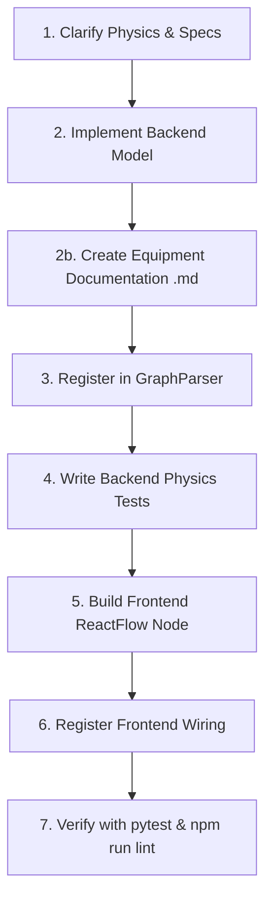

# Equipment Creation Guide for WalFlow

This skill guides you through implementing and registering a new hydraulic component in WalFlow across both the Python physics engine (**Backend**) and the ReactFlow diagram canvas (**Frontend**).

---

## 🧭 Overview & Core Principles

WalFlow is a web-based hydraulic process simulator consisting of:
* **Backend:** Python / FastAPI steady-state solver calculating algebraic equilibrium ($P, Q, T, v$).
* **Frontend:** React + ReactFlow visual drag-and-drop canvas.

### Fundamental Simulation Principles
1. **Steady-State Static Solver ($\Delta t = 0$):** All equipment equations must be static algebraic relationships. **No time-stepping, no dynamic charging/discharging ($P_1 V_1^n = P_2 V_2^n$), no time-dependent tank filling, no dynamic water hammer.**
2. **Smooth Continuity ($C^0$ and $C^1$):** Equations and derivatives must be continuously differentiable across all flow regimes to guarantee Newton-Raphson solver convergence.
3. **Jacobians:** The solver differentiates component pressure drops numerically (central difference), except for pipes and pumps, which supply an analytical `calculate_dp_derivative`. For other components the analytical derivative is optional; the drop itself must be smooth enough for the numerical one.

---

## 📋 End-to-End Development Workflow



### Step 1: Clarify Physics & Specs
Before writing code, define the component requirements:
- **Node Type ID:** Unique snake_case string (e.g. `pressure_safety_valve`, `calibrated_restriction`).
- **Archetype:** In-line resistance, flow source, boundary, dynamic closed valve (MCP), thermal unit, or multi-port junction.
- **Governing Standard:** Formal standard (e.g. ISO 5167, ISO 4126, IEC 60534, Crane TP 410).
- **Port Configuration:** Number of inlets and outlets (usually 1 inlet + 1 outlet, or multi-port like 1 in / 2 out).
- **Physical Parameters & Units:** Ensure parameters use standard engineering units in UI (bar, L/min, °C, kW) and convert to SI units (Pa, $\text{m}^3/\text{s}$, K, W) in backend.

### Step 2: Implement Backend Class
Create `backend/simulation/equipment/<name>.py` inheriting from `HydraulicNode`:
- Initialize ports via `self.add_inlet()` and `self.add_outlet()`.
- Set solver categorization flags (`is_pressure_boundary`, `blocks_flow_on_shutdown`, `use_mcp_formulation`).
- Implement `calculate_delta_p(flow_rate, density, viscosity)`; `calculate_dp_derivative(flow_rate, density, viscosity)` is optional (the solver uses it for pipes and pumps only).
- Implement `calculate()` to propagate outlet pressure, flow rate, and thermal effects ($dT = \frac{|\Delta P|}{\rho \cdot C_p}$).

📖 **Deep Dive Reference:** Read [references/backend-physics.md](references/backend-physics.md) and [references/solver-stability.md](references/solver-stability.md).

### Step 2b: Create Companion Documentation (`<name>.md`)
Create `backend/simulation/equipment/<name>.md` with exactly these headings (reference example: `orifice.md`):
1. `## 1. Overview & Purpose`
2. `## 2. Governing Standards & Reference Literature`
3. `## 3. Physical & Mathematical Implementation` (equations as the code implements them, regime blending, analytical derivative, solver formulation)
4. `## 4. Thermal & Energy Balance`
5. `## 5. Parameter & Unit Specification Table`
6. `## 6. Operating Modes & Model Boundaries` (including the solver flags)
7. `## 7. Verification & Benchmarks` (values taken only from existing test assertions)
8. `## Data Fields` last: every key the parser reads from the node's `data`, with its unit in the file and default (checked by `backend/tests/unit/solver/test_node_fields_documented.py`).

A section that does not apply keeps its heading with one line saying why. Shared physics (e.g. `relief_device.md`) gets its own document that the component documents link to.

📖 **Deep Dive Reference:** Read [references/equipment-documentation-standard.md](references/equipment-documentation-standard.md).


### Step 3: Register in Graph Parser
In `backend/simulation/graph_parser.py`:
1. Import the new equipment class.
2. In `GraphParser._build_node(node_data, global_settings)` (called by `create_node`, which turns empty or non-numeric fields into a `ModelInputError`), add a branch for your `node_data.type` to deserialize incoming parameters with unit conversions:
   - Pressure: $\text{bar} \times 10^5 \to \text{Pa}$
   - Flow: $\text{L/min} / 60\,000 \to \text{m}^3/\text{s}$
   - Power: $\text{kW} \times 1\,000 \to \text{W}$
   - Temperature: $^{\circ}\text{C} + 273.15 \to \text{K}$
3. **Field names carry their unit**: `_pa`, `_bar`, `_barg`, `_bara`, `_lmin`, `_c`, `_k`, `_m`, `_mm`, `_kw`, `_w_k`, `_pct`, `_deg`, `_mpas`, e.g. `d.get('flow_rated_lmin', 100.0)`. Unitless fields (text, bool, Cv) have no suffix. Pipe (edge) fields are `length_m`, `diameter_m` and `roughness_mm` (see `backend/simulation/equipment/pipe.md`). Renaming an existing field: before a release, rename it everywhere (saved files are not converted). After a release, a rename is a file format incompatibility and follows the Versioning Policy in `AGENTS.md`.

### Step 4: Write Backend Unit & Physics Tests
Follow the `walflow-qa` skill (section "New equipment"):
- Add the component's node `data` strategy to `RESISTANCE_DATA` or `PUMP_DATA` in `backend/tests/helpers/strategies.py`; the contract suite (`test_equipment_contracts.py`) then checks zero-flow, sign, monotonicity and purity automatically.
- Create `backend/tests/unit/equipment/test_<name>.py` with reference rows for the component's own numbers (calibration point, standard, worked example) against an independent reference.
- Add a network scenario only if the component interacts with controllers, relief or topology handling.

📖 **Deep Dive Reference:** Read [references/testing-verification.md](references/testing-verification.md).

### Step 5: Build Frontend Node Component
Create `frontend/src/nodes/<Name>Node.jsx`:
- Wrap with `<BaseNode id={id} data={data} selected={selected} width={...} height={...} footer={...}>`.
- Render SVG icon / visual symbol.
- Add `<Handle>` elements with rotation compensation (`getRotatedPosition(Position.Left, rotation)`).
- Add `<SensingPin>` for signal telemetry if applicable.

📖 **Deep Dive Reference:** Read [references/frontend-integration.md](references/frontend-integration.md).

### Step 6: Register Frontend Wiring
Update the following frontend files:
1. `frontend/src/App.jsx`:
   - Import node and add to `nodeTypes` object.
   - Add default properties to `DEFAULTS_BY_TYPE` in `frontend/src/utils/nodeDefaults.js` (same field names and defaults as the parser and the `## Data Fields` table).
2. `frontend/src/components/panels/Sidebar.jsx`:
   - Add item to appropriate category in `categorizedEquipment`.
3. `frontend/src/components/panels/SetupPanel.jsx`:
   - Add input controls for editing component properties.
4. `frontend/src/components/symbols/SymbolLibrary.jsx`:
   - Add SVG symbol rendering case under `EquipmentSymbol`.
5. *(Optional)* `frontend/src/components/details/<Name>Details.jsx` and `ResultsPanel.jsx` for dedicated live charts/telemetry.

### Step 7: Verify Everything
Run the gate from the `walflow-qa` skill:
```bash
cd backend && python -m pytest
cd frontend && npm run lint && npm test && npm run build
```

---

## 🗂️ Equipment Archetype Quick Selector

| Archetype | Examples | Key Base Flags | Reference |
| :--- | :--- | :--- | :--- |
| **Passive In-line Resistors** | Orifice, Filter, Calibrated Restriction | Defaults (`False`) | [equipment-archetypes.md#archetype-1](references/equipment-archetypes.md) |
| **Active Flow Sources** | Centrifugal Pump, Volumetric Pump | $H(Q)$ curve or displacement spring, `is_relief_driver = True`; PD pump `blocks_flow_on_shutdown = True` | [equipment-archetypes.md#archetype-2](references/equipment-archetypes.md) |
| **Dynamic Closed / MCP Valves** | Check Valve, Relief Valve (PSV), Rupture Disc | `use_mcp_formulation = True` | [equipment-archetypes.md#archetype-3](references/equipment-archetypes.md) |
| **Pressure Boundaries** | Tank, Reservoir, Fixed Pressure Point | `is_pressure_boundary = True` | [equipment-archetypes.md#archetype-4](references/equipment-archetypes.md) |
| **Multi-port Flow Junctions** | Splitter, Mixer, 3-Way TCV | Direction-aware mixing | [equipment-archetypes.md#archetype-5](references/equipment-archetypes.md) |
| **Thermal Units** | Heat Exchanger, Cooler | Thermal duty / effectiveness | [equipment-archetypes.md#archetype-6](references/equipment-archetypes.md) |

---

## 📚 Detailed Reference Guides

* 📐 **[backend-physics.md](references/backend-physics.md):** Base class architecture, ports, energy balance, and fluid properties.
* 📄 **[equipment-documentation-standard.md](references/equipment-documentation-standard.md):** Template and engineering standard citation requirements for `<equipment>.md`.
* ⚡ **[solver-stability.md](references/solver-stability.md):** Newton solver guidelines, derivatives, MCP formulation, and topology reduction.
* 📦 **[equipment-archetypes.md](references/equipment-archetypes.md):** Complete code templates for all 6 equipment archetypes.
* 🖥️ **[frontend-integration.md](references/frontend-integration.md):** ReactFlow component creation, handle rotation, sidebar registration, and property editor forms.
* 🧪 **[testing-verification.md](references/testing-verification.md):** Testing methodology, calibration validation, and derivative checks.

