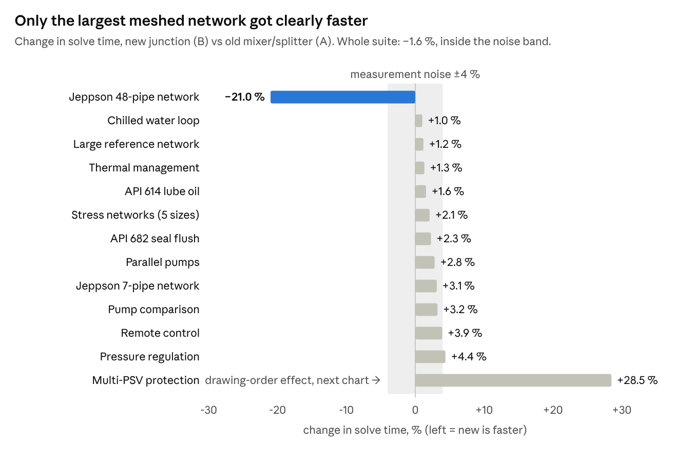
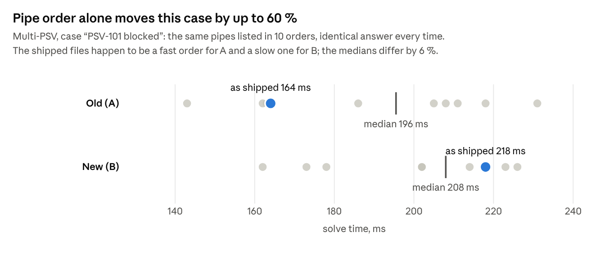

# Junction vs Mixer/Splitter: Commit Comparison

2026-10-27 · measured with [HEAD_COMPARISON.md](HEAD_COMPARISON.md)

Keep the new neutral junction. Overall it is as fast as the old mixer/splitter design (within measurement noise), 21 % faster on the largest meshed network, and it removes the main sources of solver trouble in the old design. One gap needs closing: diagrams saved with the old mixer or splitter no longer open cleanly.

## Verdict at a glance

The new junction wins on two of the three questions and ties on speed.

| Question | Old: Mixer + Splitter | New: Junction | Winner |
| --- | --- | --- | --- |
| 1. Which is faster? | 2.23 s for the full test suite | 2.19 s (1.6 % less, within noise) | Tie |
| 1b. Largest meshed network (Jeppson 48 pipes) | 0.61 s | 0.49 s (21 % less) | New |
| 2. More future-proof? | Fixed 3-way pieces; a 4-way node needs a chain of tees | One piece for 3 to 8 pipes, drawn in any direction | New |
| 3. Lower risk of solver problems? | Tiny artificial link pipes, flow-direction traps | Clean layout; one open gap with old files | New, after the gap is closed |
| Same engineering answers? | Reference | Same flows (differences under 0.04 %) | Equal |

The main branch at `5773066` (junction plus a later speed-up) runs the same suite in 2.10 s, 6 % faster than the old design, with results bit-identical to the junction commit.

## What was compared

The decision is A against B. C shows where the main branch stood on the day of the comparison.

| Label | Commit | What it is |
| --- | --- | --- |
| A — Old | `2b1205a` | Last version with two fixed pieces: a splitter (1 in, 2 out) and a mixer (2 in, 1 out) |
| B — New | `6744437` | Neutral junction with 3 to 8 ports, each usable as inlet or outlet |
| C — Today | `5773066` (main) | B plus a small solver speed-up (`dec1489`) and symbol changes |

B is not a pure redesign. It also changed one physics rule: a pipe now takes its fluid density and viscosity from the end the flow enters by, whatever direction it was drawn in.

## Speed

Speed is a tie overall. The whole suite took 2.23 s on the old design and 2.19 s on the new one, a 36 ms gap inside the 90 ms noise floor.

*Best of 4 alternating runs × 5 repeats per commit, same machine, 27 Oct 2026.*

The Jeppson 48-pipe network is 21 % faster because it now has 63 nodes instead of 93, even though the solver needs 4 % more steps. The small networks show 1–4 % extra cost on the new commit; the speed-up in main at `5773066` (C) more than recovers it, at 6 % faster than the old design overall.

| Network | A (ms) | B (ms) | C (ms) | B vs A | C vs A |
| --- | ---: | ---: | ---: | ---: | ---: |
| Jeppson 48-pipe network | 614.4 | 485.2 | 442.8 | −21.0 % | −27.9 % |
| Large reference network | 658.2 | 666.0 | 649.0 | +1.2 % | −1.4 % |
| API 614 lube oil | 274.5 | 278.8 | 269.1 | +1.6 % | −2.0 % |
| Multi-PSV protection | 237.9 | 305.7 | 297.3 | +28.5 % | +25.0 % |
| Stress networks (5 sizes) | 110.1 | 112.4 | 104.0 | +2.1 % | −5.5 % |
| Thermal management | 37.8 | 38.3 | 37.3 | +1.3 % | −1.3 % |
| Jeppson 7-pipe network | 25.6 | 26.4 | 25.2 | +3.1 % | −1.6 % |
| API 682 seal flush | 21.9 | 22.4 | 22.0 | +2.3 % | +0.5 % |
| Chilled water loop | 19.5 | 19.7 | 19.1 | +1.0 % | −2.1 % |
| Pressure regulation | 11.4 | 11.9 | 11.4 | +4.4 % | 0.0 % |
| Pump comparison | 9.3 | 9.6 | 9.3 | +3.2 % | 0.0 % |
| Remote control | 7.7 | 8.0 | 7.7 | +3.9 % | 0.0 % |
| Parallel pumps | 7.1 | 7.3 | 7.1 | +2.8 % | 0.0 % |
| **Whole suite (total of bests)** | **2227.8** | **2192.0** | **2097.8** | **−1.6 %** | **−5.8 %** |

## Why Multi-PSV looks 28 % slower

The Multi-PSV gap is not caused by the junction. The same pipes listed in a different order spread the time far more than the gap between old and new.

*Best of 3 repeats per order, 10 orders per commit, same machine, 27 Oct 2026.*

Both designs fall back to a slower backup solver twice in this case, and how long that backup takes depends on the order of the equations. The iteration counts in the benchmark do not count those backup steps, so they looked identical.

## Same answers?

Yes. Every pipe flow agrees between old and new; the few differences are explained by redrawn examples or an intended reporting change.

| Networks | Largest flow difference | Largest pressure difference | Why |
| --- | --- | --- | --- |
| 8 of 12 examples, all cases | None (identical) | None | Same layout, same maths |
| Multi-PSV, Large Reference (pumps running), stress networks | Below 0.0000001 % | Below 0.01 Pa | Rounding noise |
| Large Reference, start-up cases | None | 0.03 bar on one pipe with zero flow | Intended: a dead branch now reads the static pressure of the running line on any junction port |
| Jeppson 7 and 48 pipes | 0.03 % | 60 Pa | Drawn as in the literature now (one node per junction instead of tee chains) |

The main branch at `5773066` (C) gives bit-identical results to the junction commit (B).

## Future-proofing

The junction matches how engineers draw P&IDs and leaves room for the roadmap; the old pieces would need workarounds for each new need.

| Need | Old: Mixer + Splitter | New: Junction |
| --- | --- | --- |
| Cross or header with 4–8 pipes | Chain of 3-way tees joined by artificial short pipes | One node |
| Drawing direction | Pipes must be drawn along the expected flow | Any direction; the solver decides the flow |
| Flow reverses in another operating case | Still solves, but a "mixer" then splits — misleading labels | Neutral, nothing to mislabel |
| Literature networks (validation) | Jeppson 48: 93 nodes, 108 pipes | Jeppson 48: 63 nodes, 78 pipes, as published |
| Roadmap: tee loss per branch | No stable branch identity once tees are chained | Each port is a fixed place to attach a loss |
| Pieces to maintain | 2 classes, 2 symbols, 2 docs | 1 class, 1 symbol, 1 doc, plus a port-mapping step in the parser |
| Opening diagrams saved before the change | Not applicable | Not supported yet (see risks) |

## Risk of solver problems and mix-ups

The old design carries more built-in solver risk; the new one has one urgent gap that is easy to close and two smaller items to watch.

| Risk | Design | Severity | What it means |
| --- | --- | --- | --- |
| Old diagrams with mixer or splitter crash the solve | New | High until fixed | The file format stayed 0.2, so such files still load. The backend turns the unknown pieces into empty nodes, then fails with an internal error instead of a clear message. Affects saved and cloud projects. |
| Artificial 1 cm link pipes beside 900 m pipes | Old | High | Needed for every 4-way node. Resistances 90,000× apart make the equations badly balanced, a common cause of slow or failed convergence. |
| Two pipes silently share one port | Old | Medium | The old backend accepted it without warning; the test stress network did exactly this, leaving the second splitter outlet unused. The new backend rejects it. |
| Flow-direction traps | Old | Medium | A node where all pipes flow in needs one pipe drawn against the flow; labels say "mixer" where flow splits. |
| Port-to-slot translation layer | New | Low | The parser maps each port to an inlet or outlet slot, and sensing lines and results are translated back. Covered by tests that redraw networks in random directions and check the answers do not change. |
| Code that still assumes "inlet = upstream" | New | Low today | A few solver spots read a node's first inlet. Harmless for a junction now, but worth checking when tee losses per port are added (noted in ROADMAP.md). |
| Solve time depends on drawing order | Both | Low | Reordering pipes in a file changes solve time by up to 60 % with the same answer (see the Multi-PSV chart). Not caused by the junction. |

## Recommended follow-ups

- [ ] Handle old diagrams: convert mixer and splitter to a 3-port junction on load, or raise the file format version so old files get a clear message instead of a crash.
- [ ] Make the backend reject unknown component types with a named input error rather than creating an empty node.
- [ ] Note in the benchmark guide that equal iteration counts do not prove an equal solver path: fallback-solver evaluations are not counted, and pipe order alone moves solve time.

## How it was measured

- Method of [HEAD_COMPARISON.md](HEAD_COMPARISON.md), with commit hashes in place of branch names (`git worktree add --detach <path> <commit>`): each commit in its own checkout, one Python 3.14 environment, same Windows 11 machine.
- 4 timing runs per commit in alternating order (A B C C B A A B C B A C), 5 repeats per case, best time kept. Suite: 32 example cases and 5 stress networks (5 to 100 parallel loops).
- Noise floor: run-to-run spread of the total was 19–31 ms; a difference under about 90 ms (3× spread) is not counted as a result.
- Results compared value by value with the `snapshot` / `compare` commands of `profile_solver.py`; the drawing-order test shuffled the pipe list 9 times per commit.
- Design and risk review from the code diff, the equipment docs and the tests of each commit; an old file was run on the new code to confirm the crash.
